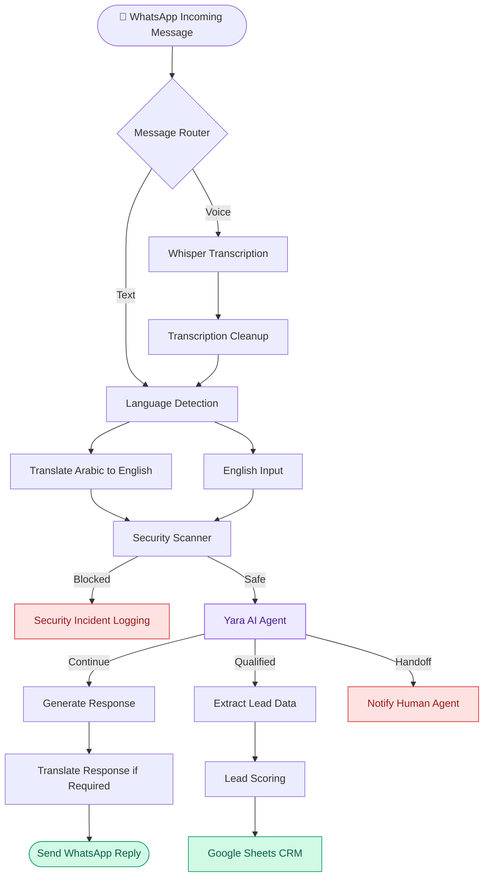
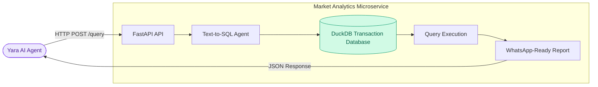
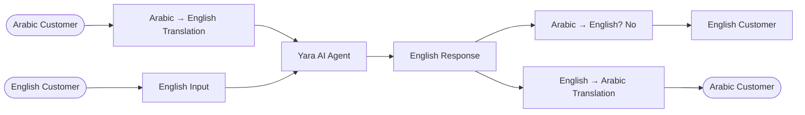

# 🏙️ AI-Powered Bilingual WhatsApp Real Estate Lead Generation

  <strong>An intelligent, multi-agent automation system for UAE real estate agencies.</strong>
   
  Automate lead qualification, deliver bilingual customer experiences, and provide data-grounded Dubai real estate market insights — directly through WhatsApp.

  
  
  
  
  

---

## 📖 Overview

Real estate agencies in the UAE receive inquiries around the clock, often from customers who speak different languages and expect accurate, immediate responses.

This project introduces **Yara**, an AI-powered real estate concierge that automates the initial stages of customer engagement.

Built with n8n, OpenAI, FastAPI, and DuckDB, the system combines conversational AI with real estate transaction analytics to transform incoming WhatsApp messages into structured, actionable sales leads.

### ✨ Key Features

- **24/7 WhatsApp Automation** — Responds automatically to incoming customer inquiries.
- **Bilingual Conversations** — Supports Arabic and English conversations with language-aware responses.
- **Voice Message Processing** — Transcribes WhatsApp voice notes using OpenAI Whisper.
- **Intelligent Lead Qualification** — Collects structured information through a conversational five-field qualification process.
- **Market Intelligence** — Queries Dubai Land Department transaction data through a dedicated analytics API.
- **Lead Scoring** — Assigns qualification scores and categorizes prospects into actionable lead tiers.
- **Automated CRM Integration** — Synchronizes qualified leads with Google Sheets.
- **Human Agent Handoff** — Escalates conversations requiring human intervention.
- **Security-Oriented Architecture** — Implements input validation, prompt hardening, output inspection, and rate limiting.
- **Privacy Awareness** — Includes consent and data deletion workflows designed around UAE PDPL considerations.

---

## 🎯 The Problem

Real estate businesses lose valuable opportunities when customer inquiries are not handled effectively.

| Challenge | Impact |
|---|---|
| Delayed responses | Prospective buyers lose interest before an agent responds |
| Language barriers | Arabic-speaking customers experience friction during qualification |
| Inaccurate market information | Unverified pricing claims undermine customer trust |
| Manual qualification | Sales teams spend time collecting repetitive information |
| Fragmented lead management | Important customer information is lost across conversations |

### The Solution

Yara provides an automated first-response and qualification layer that:

1. Receives customer messages through WhatsApp.
2. Processes text and voice inquiries.
3. Detects the customer's language.
4. Applies security checks before processing.
5. Conducts a conversational lead qualification.
6. Retrieves database-backed market insights when necessary.
7. Scores qualified leads and synchronizes them with the CRM.
8. Responds in the customer's original language or escalates to a human agent.

---

## 🏗️ System Architecture

The system is organized into two independently deployable layers.

### Layer 1 — Conversational Intelligence

The n8n orchestration layer manages WhatsApp communication, AI processing, lead qualification, and CRM integration.

### Layer 2 — Real Estate Market Intelligence

The market intelligence layer exposes a FastAPI endpoint that allows Yara to retrieve analytical insights from real estate transaction data.

**Architecture Highlights**

- Conversational processing and market analytics are decoupled.
- n8n communicates with FastAPI through HTTP requests.
- DuckDB handles analytical queries against transaction data.
- Market insights are generated from database results rather than relying on model knowledge alone.
- Each service can be maintained and scaled independently.

---

## 🤖 Multi-Agent AI Pipeline

The system uses six specialized processing components, each responsible for a distinct stage of the workflow.

| Component | Technology | Responsibility |
|---|---|---|
| **01 — Voice Transcriber** | OpenAI Whisper | Converts WhatsApp voice notes into text |
| **02 — Cleanup Agent** | GPT-4o-mini | Removes transcription noise and improves readability |
| **03 — Language Detector** | GPT-4o-mini | Identifies English, Arabic, and Arabizi inputs |
| **04 — Security Scanner** | Regex + GPT-4o-mini | Detects malicious instructions, abuse, and unsafe inputs |
| **05 — Yara Qualification Agent** | GPT-4o-mini + DuckDB Tool | Conducts conversations, qualifies leads, and retrieves market insights |
| **06 — Lead Extraction & Scoring** | GPT-4o-mini + JavaScript | Extracts structured lead information and calculates qualification scores |

---

## 🌐 Bilingual Conversation Architecture

A central design principle is the separation of language translation from conversational reasoning.

Yara operates on English input and generates English responses. Dedicated translation stages handle Arabic localization.

### Why This Design?

- **Consistent reasoning:** The conversational agent operates within a standardized language.
- **Simplified tool integration:** Market analytics requests are normalized into English.
- **Separation of concerns:** Translation quality can be improved independently of conversational logic.
- **Maintainability:** Language processing and qualification workflows remain modular.

---

## 📊 Intelligent Lead Qualification & Scoring

Yara collects five qualification fields through natural conversation:

| Field | Description |
|---|---|
| **Intent** | Buying, investing, or renting |
| **Budget** | Customer's available property budget |
| **Timeline** | When the customer plans to transact |
| **Financing** | Cash, mortgage, or other financing preference |
| **Golden Visa Interest** | Whether the customer is interested in UAE Golden Visa eligibility |

### Lead Scoring Model

Qualified leads are assigned a score out of 100.

| Factor | Maximum Points | Scoring Criteria |
|---|---:|---|
| Intent | 20 | Buy / Invest: 20 · Rent: 10 |
| Timeline | 20 | Immediate / ≤3 months: 20 · 6 months: 10 |
| Financing | 20 | Cash / Mortgage: 20 · Unknown: 0 |
| Budget | 30 | ≥5M AED: 30 · 1M–5M AED: 20 · <1M AED: 10 |
| Golden Visa Interest | 10 | Yes: 10 · No: 0 |

Customer budgets are normalized to AED before scoring, supporting AED, USD, and EUR inputs.

### Lead Prioritization

| Tier | Score | Classification | Recommended Action |
|---|---:|---|---|
| 🔴 A | 80–100 | Hot Lead | Immediate agent follow-up |
| 🟠 B | 50–79 | Warm Lead | Follow up within 24 hours |
| 🟡 C | 30–49 | Cool Lead | Add to nurture sequence |
| ⚪ D | <30 | Cold Lead | Low-priority follow-up |

---

## 🛡️ Security Architecture

Security is integrated into the message-processing pipeline through four complementary layers.

| Layer | Mechanism | Purpose |
|---|---|---|
| **01 — Input Validation** | Regex + validation rules | Detect suspicious patterns, oversized payloads, and malformed inputs |
| **02 — Prompt Hardening** | Hardened system instructions | Maintain instruction boundaries and reduce prompt injection risks |
| **03 — Output Inspection** | Response scanning | Detect potential leakage of internal instructions or sensitive content |
| **04 — Rate Limiting** | Per-phone throttling | Reduce abuse and excessive API
